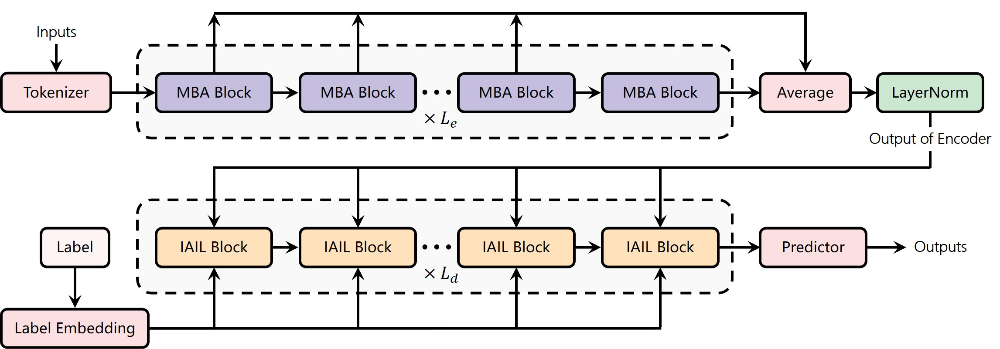
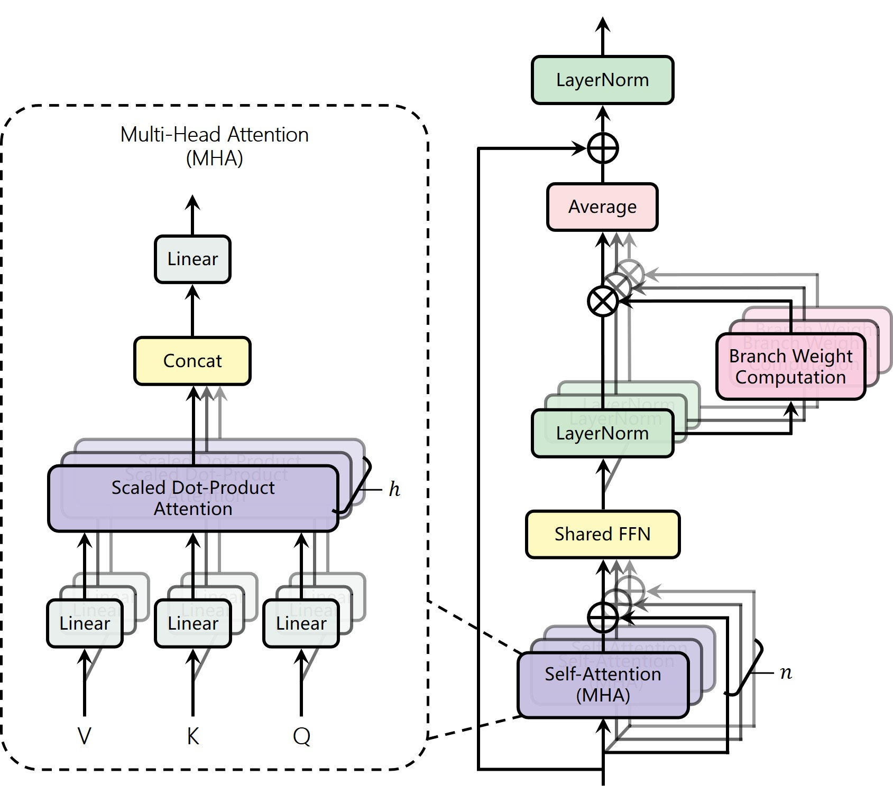
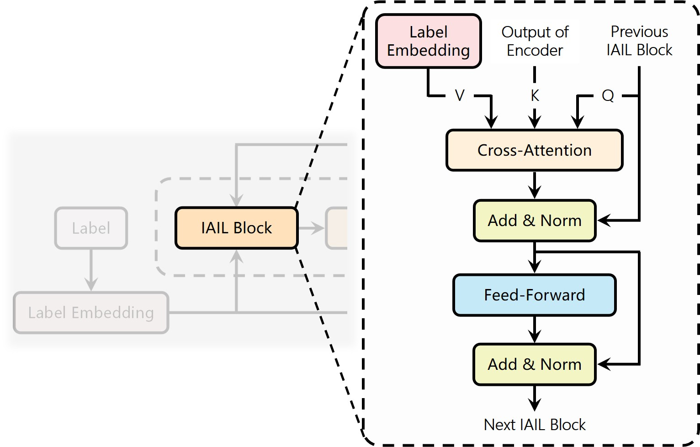

# Multi-branch of Attention Yields Accurate Results for Tabular Data

This repository is the official implementation of Multi-branch of Attention Yields Accurate Results for Tabular Data. 

📋 We propose MAYA, an encoder-decoder transformer-based framework. In the encoder, we design a **M**ulti-**B**ranch of **A**ttention (**MBA**) that constructs multiple parallel attention branches and averages the features at each branch, effectively fusing heterogeneous features while limiting parameter growth. In the decoder, cross-attention is utilized to seamlessly integrate tabular data with corresponding label information. This dual-attention mechanism effectively captures both intra- and inter-instance interactions.

👇Figure 1. The overall structure of the proposed MAYA
<div align="center">
    
</div>

<br/>

👇Figure 2. The overview of MBA (Multi-branch Attention) block in the encoder of MAYA.
<div align="center">
    
</div>

<br/>

👇Figure 3. The overview of IAIL (Inter-instance Attention Incorporated with Labels) block in decoder of MAYA.
<div align="center">
    
</div>

<br/>

## Requirements

To install requirements:

```
pip install -r requirements.txt
```

To set up the environment:

```
bash env_setup.sh
```

## Files Specification
- 📁 **data** : all datasets used in our paper
- 📁 **models** : all related with models
    - 📁 **models/modeling** : modeling py files for all models
    - 📁 **models/model_configs** : hyperparameters configs for all models 

## Training
To tune and train models by shell script:
```
bash ./train_and_tune_models.sh
```

Or run 
```
python train_and_tune_models.py
```

## Contributing
TBD